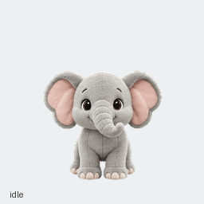

# Momo the elephant

Momo is a friendly, curious plush elephant companion created for ChatGPT Pets. It has soft gray fur, expressive pink ears, and a short flexible trunk.

## Files

- [Final sprite sheet](momo-spritesheet.png): transparent PNG, 1536 × 2288 pixels, v2 format, 73 poses.
- [Animation video](previews/all-states.mp4), [idle-to-jump preview](previews/idle-jump-idle.gif), and [look loop](previews/look-loop.gif).
- [Contact sheet](contact-sheet.png) and [sixteen-direction review sheet](direction-sheet.png).
- `artifacts/decoded/`: generated source artwork, including retained revisions.
- `artifacts/prompts/` and `artifacts/references/`: generation prompts and identity/layout references.
- `artifacts/qa/`: frame, chroma, continuity, direction, independent visual review, and quality reports.
- `artifacts/final/`: assembled sheets and final validation.
- [Pet record](pet-record.json): durable pet ID and verified active state at creation. No expiring upload or download links are stored.

## Validation

The exact final PNG passed the bundled atlas and quality checks, independent blind direction review, and the Pets service preflight. The jump lifts 62 pixels and lands on the idle baseline. Two subtle intermediate gaze directions have documented review warnings; all cardinal and independent axis checks passed.

SHA-256: `4498f1938b777494e377b44a3a3d1189d977e2305553e4d07c12633f18d28ec8`.

Momo was generated with the built-in image generation tool and assembled deterministically. The assets were saved locally at the owner's request. This repository backs up the pet's artwork and creative record; the active pet remains managed by ChatGPT Pets.

For reuse, start with `momo-spritesheet.png`. The asset format and import support depend on the Pets client. The initial concept is `momo-concept.png`.
